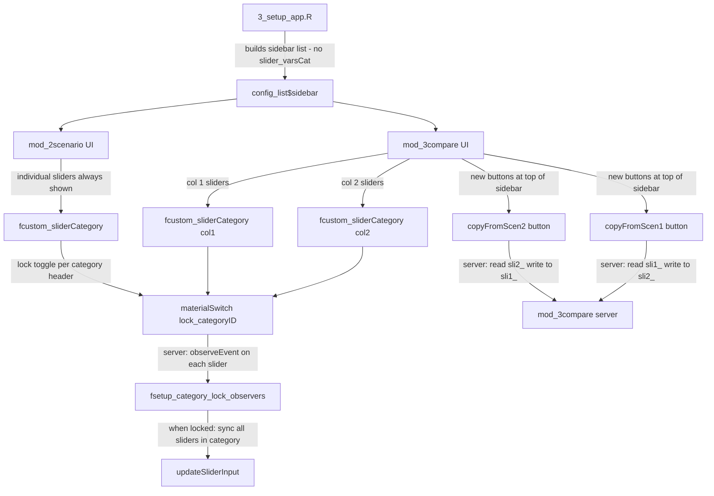

# Plan: Slider Restructure — Individual Only + Category Lock + Compare Copy Buttons

**Date:** 2026-10-30
**Scope:** `shinyplanr` package + three downstream apps (Kiribati, WestPacific, YapCoastal)

> **Rules applied from CLAUDE.md / .roo:**
> - `observeEvent()` only — never `observe()`
> - `reactiveValues()` only — never `reactive()` or `reactiveVal()`
> - No non-ASCII characters in `R/` files — use `\uXXXX` unicode escapes
> - Don't use `@importFrom` roxygen tags. Rather use :: syntax
> - After changes: `devtools::load_all()`, `devtools::test()`, `devtools::check()`
> - Invite user to test with `golem::run_dev()` after each change
> - Follow tidyverse style; use `air format .`

---

## Summary of Changes

Three distinct features are implemented together:

1. **Remove master & category sliders** — individual sliders are now the only mode
2. **Category lock toggle** — a small toggle next to each category header lets the user link all sliders in a category so they move together
3. **Compare copy-targets buttons** — two buttons at the top of the compare sidebar let the user copy all targets from one scenario column to the other

---

## Architecture Overview



---

## Feature 1 — Remove Master & Category Sliders

### What is removed

| Location | What to remove |
|----------|---------------|
| [`R/mod_2scenario.R`](../R/mod_2scenario.R) | `switchMasterTargets` hidden div (master slider + reset button) |
| [`R/mod_2scenario.R`](../R/mod_2scenario.R) | `switchCategoryTargets` hidden div (category sliders + reset button) |
| [`R/mod_2scenario.R`](../R/mod_2scenario.R) | `switchIndividualTargets` hidden div wrapper — individual sliders become always-visible |
| [`R/mod_2scenario.R`](../R/mod_2scenario.R) | `observeEvent(input$masterSli, ...)` server block |
| [`R/mod_2scenario.R`](../R/mod_2scenario.R) | `observeEvent({purrr::map(slider_varsCat$id_in, ...)}, ...)` server block |
| [`R/mod_2scenario.R`](../R/mod_2scenario.R) | `fresetSlider(session, slider_varsCat)` and `updateSliderInput(... "masterSli" ...)` from reset observer |
| [`R/mod_2scenario.R`](../R/mod_2scenario.R) | `slider_varsCat` from `rlang::env_bind()` null-init list |
| [`R/utils_server.R`](../R/utils_server.R) | `switch(options$targetsBy, ...)` block in `fapply_ui_switches()` |
| [`inst/templates/setup/3_setup_app.R`](../inst/templates/setup/3_setup_app.R) | `targetsBy = "individual"` from `shinyplanr_options` |
| [`inst/templates/setup/3_setup_app.R`](../inst/templates/setup/3_setup_app.R) | `slider_varsCat = shinyplanr:::fcreate_vars(...)` from `sidebar$scenario` |

### What the scenario sidebar becomes

The `switchIndividualTargets` wrapper div is removed. The individual sliders section becomes:

```r
shiny::h2("1. Select Feature Targets"),
shiny::actionButton(ns("resetSlider"), "Reset All Features", ...),
shiny::hr(...),
fcustom_sliderCategory(slider_vars, labelNum = 1, byCategory = FALSE),
```

No hidden div, no `shinyjs::show()` needed — always visible.

### Compare module

`mod_3compare` already only uses `Vars1`/`Vars2` (individual sliders) — no category slider equivalent exists there. The only change needed is removing the `slider_varsCat` null-init from the server's `rlang::env_bind()` list (it was never used in compare).

---

## Feature 2 — Category Lock Toggle

### UI changes — [`R/utils_ui.R`](../R/utils_ui.R) `fcustom_sliderCategory()`

**New parameter:** `lock_prefix` (character, default `"lock_"`)

The function currently renders:
```
h3("1.1 Habitat")
[slider_A] [slider_B] [slider_C]
```

New rendering:
```
div(style="display:flex; align-items:center; gap:8px;")
  h3("1.1 Habitat")
  shinyWidgets::materialSwitch(inputId = ns(paste0(lock_prefix, categoryID)),
                               label = "Lock", value = FALSE, status = "primary",
                               inline = TRUE)
[slider_A] [slider_B] [slider_C]
```

The toggle ID pattern: `paste0(lock_prefix, categoryID)` — e.g. `lock_Habitat` for scenario, `lock1_Habitat` / `lock2_Habitat` for compare columns.

**`labelCategory = FALSE` case (compare right column):** The spacer `<h3>&nbsp;</h3>` is kept but no lock toggle is rendered (the left column's toggle controls both columns independently — each column has its own lock).

**`byCategory = TRUE` case (silent features, bioregions):** No lock toggle — these already have one slider per category.

### New server helper — [`R/utils_server.R`](../R/utils_server.R) `fsetup_category_lock_observers()`

Uses `observeEvent()` only (CLAUDE.md rule). Uses `::` syntax throughout (CLAUDE.md rule). No non-ASCII characters in R code.

**Reactive cycle risk:** When slider A moves and the lock is on, the observer updates sliders B and C. Those updates fire their own `observeEvent` handlers, which check the lock and try to update A and each other. To break this cascade, each observer uses `shiny::isolate()` to read the current value of the target slider before calling `updateSliderInput` — if the value is already correct, no update is sent.

```r
fsetup_category_lock_observers <- function(input, session, slider_vars,
                                            lock_prefix = "lock_") {
  # For each category, register an observeEvent on every slider in that category.
  # When the slider moves AND the lock toggle for that category is TRUE,
  # update all other sliders in the same category to the same value.
  # Uses :: syntax throughout (no @importFrom needed -- CLAUDE.md rule).
  categories <- unique(slider_vars$category)
  purrr::walk(categories, function(cat) {
    cat_sliders <- dplyr::filter(slider_vars, .data$category == cat)
    cat_id      <- cat_sliders$categoryID[1]
    lock_id     <- paste0(lock_prefix, cat_id)

    purrr::walk(cat_sliders$id_in, function(moved_id) {
      shiny::observeEvent(
        input[[moved_id]],
        {
          if (!isTRUE(input[[lock_id]])) return()
          new_val <- input[[moved_id]]
          others  <- setdiff(cat_sliders$id_in, moved_id)
          # Only update sliders whose current value differs from new_val.
          # This breaks the reactive cascade: B's observer fires, sees its value
          # already equals new_val, and skips the updateSliderInput call.
          purrr::walk(others, function(other_id) {
            current <- shiny::isolate(input[[other_id]])
            if (!identical(current, new_val)) {
              shiny::updateSliderInput(session, other_id, value = new_val)
            }
          })
        },
        ignoreInit = TRUE
      )
    })
  })
  invisible(NULL)
}
```

### Server call sites

**`mod_2scenario_server()`** — add after `fsetup_lock_observers(...)`:
```r
fsetup_category_lock_observers(input, session, slider_vars, lock_prefix = "lock_")
```

**`mod_3compare_server()`** — add after `fsetup_lock_observers(...)` for each scenario:
```r
fsetup_category_lock_observers(input, session, Vars1, lock_prefix = "lock1_")
fsetup_category_lock_observers(input, session, Vars2, lock_prefix = "lock2_")
```

### `fcustom_sliderCategory()` call sites updated

| Call site | `lock_prefix` argument |
|-----------|----------------------|
| `mod_2scenario_ui()` — individual sliders | `lock_prefix = "lock_"` |
| `mod_3compare_ui()` — col 1 sliders | `lock_prefix = "lock1_"` |
| `mod_3compare_ui()` — col 2 sliders | `lock_prefix = "lock2_"` (but `labelCategory = FALSE` so no toggle rendered) |
| Silent feature sliders (both modules) | no lock toggle — `byCategory = TRUE` path unchanged |
| Bioregion sliders (both modules) | no lock toggle — `byCategory = TRUE` path unchanged |

**Note:** `shinyWidgets` is already a dependency of this package (used by `fcustom_checkCategory()`), so `materialSwitch` requires no new package dependency.

---

## Feature 3 — Compare Copy-Targets Buttons

### UI — [`R/mod_3compare.R`](../R/mod_3compare.R) `mod_3compare_ui()`

Insert a `splitLayout` with two action buttons immediately after the `splitLayout` showing "Scenario 1 / Scenario 2" headers and before the `h2("1. Select Feature Targets")` heading.

Button labels use `shiny::icon()` (Font Awesome) to avoid non-ASCII arrow characters in R source files (CLAUDE.md rule). If plain text is preferred, use `"\u2190 Match Scenario 2"` and `"\u2192 Match Scenario 1"` (unicode escapes, not literal arrow characters).

```r
shiny::splitLayout(
  shiny::actionButton(
    ns("copyFromScen2"),
    # shiny::icon() avoids non-ASCII arrow characters in R source (CLAUDE.md rule)
    label = shiny::tagList(shiny::icon("arrow-left"), " Match Scenario 2"),
    width = "100%",
    class = "btn btn-outline-secondary btn-sm"
  ),
  shiny::actionButton(
    ns("copyFromScen1"),
    label = shiny::tagList(shiny::icon("arrow-right"), " Match Scenario 1"),
    width = "100%",
    class = "btn btn-outline-secondary btn-sm"
  )
),
```

### Server — [`R/mod_3compare.R`](../R/mod_3compare.R) `mod_3compare_server()`

Two `observeEvent` blocks added alongside the existing `resetSlider` observer. Uses `observeEvent()` only (CLAUDE.md rule). Uses `::` syntax (CLAUDE.md rule). No non-ASCII characters in R code (arrow comments use ASCII `->` not `\u2192`).

```r
# Copy all Scenario 2 targets to Scenario 1 (sli2_ -> sli1_)
shiny::observeEvent(input$copyFromScen2, {
  # Regular feature sliders
  purrr::walk2(Vars1$id_in, Vars2$id_in, function(id1, id2) {
    val <- input[[id2]]
    if (!is.null(val)) shiny::updateSliderInput(session, id1, value = val)
  })
  # Silent feature sliders
  purrr::walk2(slider_varsSilent1$id_in, slider_varsSilent2$id_in, function(id1, id2) {
    val <- input[[id2]]
    if (!is.null(val)) shiny::updateSliderInput(session, id1, value = val)
  })
  # Bioregion sliders
  purrr::walk2(slider_varsBioR1$id_in, slider_varsBioR2$id_in, function(id1, id2) {
    val <- input[[id2]]
    if (!is.null(val)) shiny::updateSliderInput(session, id1, value = val)
  })
}, ignoreInit = TRUE)

# Copy all Scenario 1 targets to Scenario 2 (sli1_ -> sli2_)
shiny::observeEvent(input$copyFromScen1, {
  purrr::walk2(Vars2$id_in, Vars1$id_in, function(id2, id1) {
    val <- input[[id1]]
    if (!is.null(val)) shiny::updateSliderInput(session, id2, value = val)
  })
  purrr::walk2(slider_varsSilent2$id_in, slider_varsSilent1$id_in, function(id2, id1) {
    val <- input[[id1]]
    if (!is.null(val)) shiny::updateSliderInput(session, id2, value = val)
  })
  purrr::walk2(slider_varsBioR2$id_in, slider_varsBioR1$id_in, function(id2, id1) {
    val <- input[[id1]]
    if (!is.null(val)) shiny::updateSliderInput(session, id2, value = val)
  })
}, ignoreInit = TRUE)
```

---

## Schema Version Bump — [`R/config_schema.R`](../R/config_schema.R)

- Increment `.shinyplanr_schema_version` from `3L` → `4L`
- Add changelog entry for version 4:

```r
`4` = c(
  "Removed slider_varsCat from sidebar$scenario (category-level master sliders are",
  "  replaced by per-category lock toggles in the UI — no setup script change needed",
  "  for the lock feature itself).",
  "Removed targetsBy from shinyplanr_options (individual sliders are now the only mode).",
  "In 3_setup_app.R:",
  "  1. Remove the slider_varsCat entry from sidebar$scenario.",
  "  2. Remove targetsBy from shinyplanr_options."
)
```

---

## Setup Script Changes (all 4 files)

The same two edits apply to all four `3_setup_app.R` files:

### Files to edit

| File | Change |
|------|--------|
| [`inst/templates/setup/3_setup_app.R`](../inst/templates/setup/3_setup_app.R) | Template (source of truth) |
| [`../shinyplanr_Kiribati/setup/3_setup_app.R`](../../shinyplanr_Kiribati/setup/3_setup_app.R) | Downstream app |
| [`../shinyplanr_WestPacific/setup/3_setup_app.R`](../../shinyplanr_WestPacific/setup/3_setup_app.R) | Downstream app |
| [`../shinyplanr_YapCoastal/setup/3_setup_app.R`](../../shinyplanr_YapCoastal/setup/3_setup_app.R) | Downstream app |

### Edit 1 — Remove `targetsBy` from `shinyplanr_options`

Remove this line from the options list:
```r
targetsBy = "individual",  # "individual", "category", or "master"
```

### Edit 2 — Remove `slider_varsCat` from `sidebar$scenario`

Remove this block from the `sidebar$scenario` list:
```r
slider_varsCat = shinyplanr:::fcreate_vars("2scenario_ui_1", Dict, "sli_",
                                            categoryOut = TRUE, byCategory = TRUE),
```

**Note:** The downstream apps do not need to re-run `3_setup_app.R` immediately — the schema version bump will trigger a warning when `load_config()` is called, prompting the user to re-run the script. The `slider_varsCat` key being present in an old config is harmless (it is simply ignored by the new code). The `targetsBy` key being present is also harmless — it is no longer read by `fapply_ui_switches()`.

---

## `data-raw/build_stub_sysdata.R` Changes

Remove `slider_varsCat` from the stub `sidebar$scenario` structure so that the stub config used in tests matches the new schema.

---

## Files Affected — Complete List

### `shinyplanr` package

| File | Change type |
|------|-------------|
| [`R/utils_ui.R`](../R/utils_ui.R) | Add `lock_prefix` param + lock toggle to `fcustom_sliderCategory()` |
| [`R/utils_server.R`](../R/utils_server.R) | Remove `targetsBy` switch; add `fsetup_category_lock_observers()` |
| [`R/mod_2scenario.R`](../R/mod_2scenario.R) | Remove master/category divs & observers; call lock helper; simplify reset |
| [`R/mod_3compare.R`](../R/mod_3compare.R) | Add copy buttons UI; add copy observers; add lock observers |
| [`R/config_schema.R`](../R/config_schema.R) | Bump schema to 4; add changelog entry |
| [`inst/templates/setup/3_setup_app.R`](../inst/templates/setup/3_setup_app.R) | Remove `targetsBy`, `slider_varsCat` |
| [`data-raw/build_stub_sysdata.R`](../data-raw/build_stub_sysdata.R) | Remove `slider_varsCat` from stub |
| [`tests/testthat/test-mod_2scenario.R`](../tests/testthat/test-mod_2scenario.R) | Update for removed inputs |
| [`tests/testthat/test-mod_3compare.R`](../tests/testthat/test-mod_3compare.R) | Update for new buttons |
| [`tests/testthat/test-utils_ui.R`](../tests/testthat/test-utils_ui.R) | Update for new `lock_prefix` param |
| [`tests/testthat/test-utils_server.R`](../tests/testthat/test-utils_server.R) | Update for removed `targetsBy` switch |

### Downstream apps

| File | Change type |
|------|-------------|
| [`../shinyplanr_Kiribati/setup/3_setup_app.R`](../../shinyplanr_Kiribati/setup/3_setup_app.R) | Remove `targetsBy`, `slider_varsCat` |
| [`../shinyplanr_WestPacific/setup/3_setup_app.R`](../../shinyplanr_WestPacific/setup/3_setup_app.R) | Remove `targetsBy`, `slider_varsCat` |
| [`../shinyplanr_YapCoastal/setup/3_setup_app.R`](../../shinyplanr_YapCoastal/setup/3_setup_app.R) | Remove `targetsBy`, `slider_varsCat` |

---

## Verification Steps (after implementation)

Per CLAUDE.md development workflow, after all changes are made:

1. **ns() audit** — for every new input ID added (lock toggles: `lock_<catID>`, copy buttons: `copy_col1_to_col2`, `copy_col2_to_col1`), confirm each is wrapped in `ns()` in the module UI function. Use the `.claude/skills/golem-fix-missing-ns` skill as a checklist.
2. `devtools::load_all()` — confirm no errors or new warnings
3. `devtools::test()` — confirm all tests pass
4. `devtools::check()` — confirm clean R CMD check
5. `air format .` — format all R files
6. Invite user to test interactively with `golem::run_dev()`

---

## Key Design Decisions

**Lock toggle uses `shinyWidgets::materialSwitch`** — already a package dependency (used by `fcustom_checkCategory()`), visually compact, renders inline with the category header. No new dependency needed.

**Lock is server-side fan-out with cycle guard** — when slider A moves and the lock is on, the server pushes the new value to all other sliders in the same category via `updateSliderInput`. Each observer checks `shiny::isolate(input[[other_id]])` before updating — if the value already matches, no update is sent, breaking the A->B->A reactive cycle. This is consistent with CLAUDE.md's rule to "watch for reactive cycles and break them with explicit conditions".

**Lock state is not reset by "Reset All Features"** — the reset button resets slider *values* to their initial targets; the lock toggle is a UI preference and is left in its current state. This is intentional.

**Copy buttons copy all three slider groups** — regular features, silent features, and bioregions — so the copied scenario is fully equivalent to the source.

**`targetsBy` removal is backward-compatible** — existing configs with `targetsBy` present will still load without error; the key is simply ignored. The schema version bump triggers a warning prompting users to re-run `3_setup_app.R`, at which point the key is removed.

**Downstream apps need `3_setup_app.R` re-run** — after the package is updated, each downstream app must re-run `setup/3_setup_app.R` to regenerate `config/shinyplanr_config.rds` with the new schema version. The script edits (removing `targetsBy` and `slider_varsCat`) are made now so the re-run produces a clean config.
